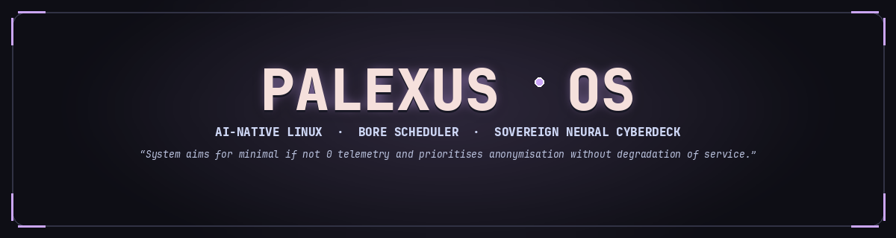
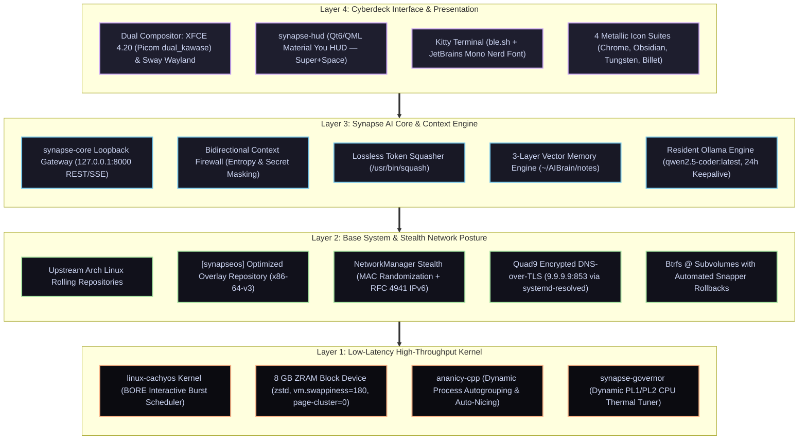
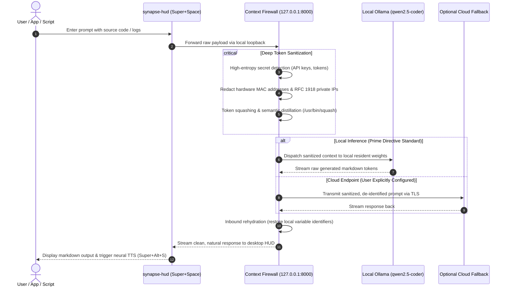
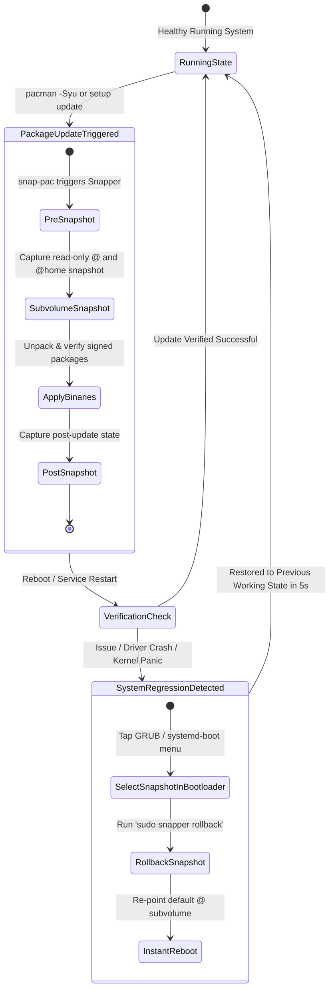
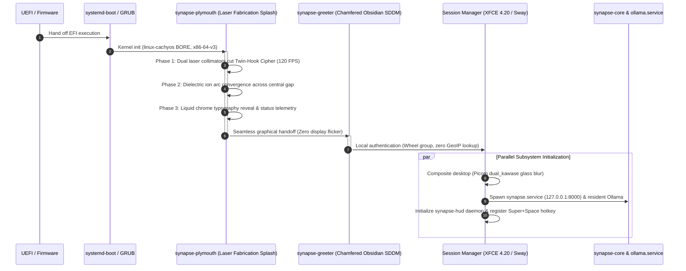
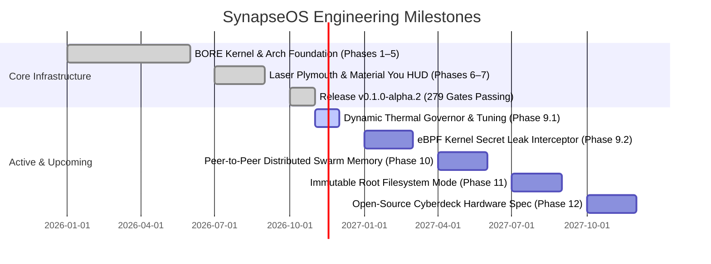

<div align="center">

# SynapseOS

### **The AI-Native Rolling Linux Workstation**  
*Surgical Precision. Zero Friction. One Brain. All Models.*

[](https://github.com/earnerbaymalay/synapseOS/actions/workflows/build-iso.yml)
[](build/verify-gates.sh)
[](https://github.com/earnerbaymalay/synapseOS/releases)
[](https://archlinux.org)
[-fab387?style=flat-square&logo=linux&logoColor=ffffff)](https://github.com/CachyOS/linux-cachyos)
[-f38ba8?style=flat-square&logo=privatedivision&logoColor=ffffff)](#-the-prime-directive-zero-telemetry-sovereignty)
[](LICENSE)

<br/>



<br/>

**SynapseOS** is an open-source, AI-native operating system designed to liberate personal computing from cloud telemetry, forced subscriptions, and interface bloat. Powered by low-latency schedulers, aggressive memory compression, and deeply integrated local neural models, SynapseOS converts any modern PC into an ultra-fast sovereign cyberdeck.

[**Get Started in 3 Steps**](#-get-started-in-3-steps) • [**1-Command Instant Demo**](#-test-drive-in-60-seconds-no-usb-required) • [**Architecture**](#-deep-system-architecture) • [**Hardware Support**](#-supported-hardware-matrix) • [**Documentation**](docs/)

</div>

---

## ⚡ Why SynapseOS? (The Plain-English Breakdown)

Modern commercial operating systems increasingly treat your hardware as a client terminal to harvest data, deliver unsolicited promotions, and charge ongoing subscriptions for basic intelligence features.

**SynapseOS turns the paradigm inside-out:**

* 🧠 **Your AI Lives on Your Silicon**: Tap **`Super + Space`** from any screen to summon your local AI assistant. Query documentation, generate code, draft technical reports, and execute system commands. The weights run **100% locally on your CPU and GPU via resident Ollama models**—no internet connection required, zero token meters, and total privacy on airplane mode.
* 🛡️ **The Prime Directive (Zero Telemetry)**: Every network interface enforces hardware MAC address randomization. IPv6 privacy extensions (RFC 4941) are active by default. Outbound DNS queries are encrypted over TLS via Quad9 (`9.9.9.9:853`), and system daemons operate with a default-drop inbound firewall posture.
* 🚀 **Instantaneous Response (BORE Scheduler & AVX2)**: Utilizing `linux-cachyos` with the **Burst-Oriented Response Enhancer (BORE)**, interactive terminal typing and UI animations retain zero-latency priority even during 100% CPU multi-threaded local AI inference or kernel compilation.
* 🛡️ **Bulletproof Snapshot Protection (Time Machine)**: Every `pacman` update automatically generates a read-only Btrfs snapshot. If an upstream regression ever occurs, roll your entire workstation back to a pristine working state in under 5 seconds directly from the bootloader.
* 🎨 **Bespoke Cyberdeck Aesthetic**: Built with dark obsidian glass, liquid chrome typography, Catppuccin Mocha Mauve palettes, laser-engraved Plymouth boot animations, and 4 precision CNC vector icon suites.

---

## 📊 How SynapseOS Compares

| Feature | Windows 11 Copilot+ | Ubuntu 24.04 LTS | Vanilla Arch Linux | CachyOS | **SynapseOS** |
| :--- | :---: | :---: | :---: | :---: | :---: |
| **Local AI Subsystem** | ❌ Cloud / NPU Only | ❌ None | ❌ DIY | ❌ DIY | **✅ Native Core & HUD** |
| **Context & Secret Firewall**| ❌ Telemetry Ingestion | ❌ None | ❌ None | ❌ None | **✅ Bidirectional Proxy** |
| **System Telemetry** | ⚠️ Pervasive / Diagnostic | ⚠️ Opt-out Metrics | ✅ Zero Default | ✅ Minimal | **🛡️ 0 (Prime Directive)** |
| **CPU Scheduler Tuning** | Standard Round-Robin | CFS / EEVDF | Standard EEVDF | BORE / BMQ | **🚀 BORE + Auto-Nicing** |
| **Microarchitecture Binaries**| Generic x86-64 | Generic x86-64 | Generic x86-64 | x86-64-v3/v4 | **⚡ x86-64-v3 (AVX2/BMI2)** |
| **Memory Compression** | Basic Pagefile | Basic Swap | DIY | ZRAM zstd | **💾 8GB ZRAM (180 Swappiness)** |
| **Rollback Time Machine** | System Restore (Slow) | Manual TimeShift | DIY Btrfs | Automated Snapper | **✅ 5-Second Boot Snapshots** |
| **First-Boot Experience** | Mandatory Online Account | Generic Installer | Terminal CLI | Calamares | **✨ Guided Cyberdeck Wizard** |

---

## 🧪 Test Drive in 60 Seconds (No USB Required!)

Want to experience SynapseOS right now without touching your disk or flashing a USB drive? Run this single command on any Linux or macOS machine with QEMU installed:

```bash
# Download the latest 2.9GB verified ISO and launch in an accelerated VM:
curl -LO https://github.com/earnerbaymalay/synapseOS/releases/latest/download/synapseos-x86_64.iso

qemu-system-x86_64 \
  -enable-kvm -m 8G -smp 4 -cpu host \
  -vga virtio -display gtk,gl=on \
  -audiodev pa,id=snd0 -device intel-hda -device hda-duplex,audiodev=snd0 \
  -cdrom synapseos-x86_64.iso -boot d
```

*(On Windows, you can launch the ISO directly inside Hyper-V, VMware Workstation, or VirtualBox with 3D Acceleration enabled).*

---

## 🚀 Get Started in 3 Steps

SynapseOS runs seamlessly on standard laptops, workstations, and custom desktops (Dell Latitude, ThinkPad, Framework, ASUS ROG, HP, Razer, Intel/AMD/NVIDIA).

> [!NOTE]
> **No Linux experience required.** You do not need to be a programmer or terminal expert. Everything can be operated via standard mouse and keyboard. When you choose to install, Calamares offers safe dual-boot alongside Windows without touching your existing personal files.

### 1. Prepare Your Media (The Ventoy Multi-Boot Way)
We recommend **[Ventoy](https://www.ventoy.net)** because it turns any USB flash drive into a reusable drag-and-drop installer:
1. Install Ventoy onto a USB drive (16 GB or larger) using the Ventoy GUI or CLI.
2. Download `synapseos-x86_64.iso` from our [GitHub Releases](https://github.com/earnerbaymalay/synapseOS/releases).
3. Copy the `.iso` file directly onto the USB partition.

> [!TIP]
> Prefer classic flashing tools? You can write the image directly using [BalenaEtcher](https://etcher.balena.io/) or the terminal:
> ```bash
> sudo dd if=synapseos-x86_64.iso of=/dev/sdX bs=4M status=progress oflag=direct
> ```

### 2. Boot into the Live Cyberdeck
1. Insert the USB drive and power on your PC.
2. Press your computer's boot selection key immediately:
   * **`F12`** for Dell, Lenovo, and Framework
   * **`F9`** for HP
   * **`F8`** or **`F11`** for ASUS, MSI, and ASRock
3. Select your USB drive and choose **SynapseOS (Live Mode)**.

### 3. Explore & Install
You are now in the live environment running directly in memory:
* Press **`Super + Space`** to open the **Synapse Command HUD** and test your local AI.
* Verify your Wi-Fi, audio output, multi-monitor display scaling, and trackpad gestures.
* When ready to install permanently, double-click **Install SynapseOS** on the desktop to launch the Calamares installer (select **Install Alongside Windows** or **Replace Entire Disk** with Btrfs).

📖 **Comprehensive walkthroughs:**
* ➡️ [**Ventoy Flashing & Boot Guide**](docs/VENTOY_BOOT_GUIDE.md)
* ➡️ [**Dual-Boot Safety & BitLocker Suspension Guide**](docs/DUAL_BOOT_AND_HARDWARE.md)

---

## ⌨️ Fluid Cyberdeck Navigation

SynapseOS is engineered around keyboard-driven ergonomics. Learn these primary shortcuts to command your workspace:

| Shortcut | Action | Description |
| :--- | :--- | :--- |
| **`Super + Space`** | **Synapse Command HUD** | Universal quick-launcher, local AI prompt bar, calculation engine, and application index. |
| **`Super + Return`** | **Kitty Terminal** | Ultra-responsive hardware-accelerated GPU terminal with JetBrains Mono and auto-completion. |
| **`Super + Ctrl + T`** | **Cycle Desktop Themes** | Instantly switch between *Liquid Chrome*, *Smoked Obsidian*, *Radial Tungsten*, and *Mauve*. |
| **`Super + Alt + S`** | **Neural Read Aloud** | Reads selected text or the latest AI response aloud using natural low-latency local speech. |
| **`Super + /`** | **Cheat Sheet Overlay** | Summons an interactive on-screen shortcut matrix at any time. |
| **`Super + Shift + Q`** | **Close Window** | Instantly closes active focused window with zero visual tearing. |

---

## 💻 Supported Hardware Matrix

SynapseOS features an automated hardware sensing engine (`synapse-hardware`) that configures thermal governors, CPU instruction paths, and GPU acceleration on boot:

| Tier | Classification | Reference Machines | Hardware Tuning |
| :--- | :--- | :--- | :--- |
| **Tier 0** | **Engineering Reference** | **Dell Latitude 7490** (Intel Core i5/i7 8th-Gen, UHD 620, 16–32 GB RAM) | **100% Certified**. Custom 25W sustained PL1 thermal profile, sub-5ms PipeWire audio, tuned trackpad gestures. |
| **Tier 1** | **Certified Laptops** | **Lenovo ThinkPad** (T14, T480, X1 Carbon), **Framework Laptop 13 & 16**, Dell XPS 13/15 | Flawless out-of-the-box hardware enablement, Wi-Fi 6E/7, Bluetooth LE, deep sleep S3/Modern Standby, automatic brightness. |
| **Tier 2** | **Universal x86-64** | AMD Ryzen 3000–9000 series, Intel 9th–14th Gen, custom gaming PCs, ASUS ROG, HP Spectre | Full AVX2 CPU vector utilization, Vulkan compute acceleration for Ollama, NVIDIA proprietary / open-kernel drivers. |

Verify your hardware health and AI thermal acceleration status anytime:
```bash
synapse-hardware status
```

📖 **Detailed hardware matrix, power profiles, and GPU notes:**  
➡️ [**docs/HARDWARE_COMPATIBILITY.md**](docs/HARDWARE_COMPATIBILITY.md)

---

## ⚙️ Deep System Architecture

SynapseOS synthesizes four proven engineering foundations into a single cohesive operating system:



### 1. Bidirectional Context Firewall (`firewall.rs`)
All application interactions with local or remote models pass through the loopback proxy at `127.0.0.1:8000`. The Context Firewall performs deep inspection to prevent credential leakage:
* **Outbound Secret Redaction**: Intercepts high-entropy hashes, private SSH/GPG keys, bearer tokens, hardware MAC addresses, and internal network IP addresses before prompts reach model weights.
* **Semantic Token Squashing**: Automatically compresses verbose terminal logs and build traces via `/usr/bin/squash`, preserving semantic density while minimizing context memory overhead.
* **Inbound Rehydration**: Reconstitutes redacted local variable names during the markdown streaming phase so you see clean, actionable code.



### 2. Time Machine Btrfs Subvolume Rollback
SynapseOS partitions disks with clean Btrfs subvolumes (`@` for root, `@home` for user data, `@snapshots` for Snapper). Before `pacman` writes a single byte during system upgrades, `snap-pac` captures an atomic snapshot:



### 3. Monolithic Laser Boot Kinematics
During system boot, the GPU directly renders a 120 FPS twin-hook laser fabrication animation via Plymouth:



---

## 🛠️ Building & Verifying from Source

The entire distribution image is fully reproducible and audited against **279 strict engineering quality gates**.

### 1. Verification Gate Harness (279/279 Passing)
Run the automated test suite locally to verify packaging syntax, kernel sysctls, theme assets, and Calamares installer recipes:

```bash
git clone https://github.com/earnerbaymalay/synapseOS.git
cd synapseOS
./build/verify-gates.sh
```

### 2. Building the Bootable ISO Image
Generate a pristine `synapseos-x86_64.iso` locally using the clean Archiso profile:

```bash
# Requires Arch Linux, archiso, and squashfs-tools:
sudo ./build/build-iso.sh
```
The finished bootable image is emitted into `out/synapseos-<timestamp>-x86_64.iso`.

### 3. Public Package Repository & SDK Recipes
Community and custom packages are built using our standalone recipe harness in [`SynapseOS/public-repo`](https://github.com/SynapseOS/public-repo):
```bash
# Clone the package recipe tree:
git clone https://github.com/SynapseOS/public-repo.git
cd public-repo

# Build and verify packages with GNU Make:
make check
make all JOBS=4
```
Packages are bundled into cryptographic `.spkg` archives with USTAR formatting and Ed25519 repository index v2 signatures.

---

## 🗺️ Engineering Roadmap



📖 **Detailed milestone specifications & changelog:**  
➡️ [**ROADMAP.md**](ROADMAP.md)

---

## 📂 Repository Directory Layout

```
synapseOS/
├── .github/workflows/       # Automated CI/CD ISO generation & 279-gate harness
├── build/                   # Archiso live image definitions & build tooling
│   ├── archiso/             # Profile definition, package lists, syslinux/systemd-boot
│   ├── build-iso.sh         # ISO packaging script
│   └── verify-gates.sh      # 279/279 Engineering gate test harness
├── docs/                    # Technical whitepapers & installation manuals
│   ├── VENTOY_BOOT_GUIDE.md # Detailed USB burning instructions
│   ├── DUAL_BOOT_AND_HARDWARE.md # BitLocker, EFI, and partitioning manual
│   ├── HARDWARE_COMPATIBILITY.md # Detailed laptop & desktop validation matrix
│   ├── ARCHITECTURE.md      # Subsystem technical whitepaper
│   └── TECHNICAL_FAQ.md     # Audio, networking, and memory tuning FAQ
├── packages/                # Native PKGBUILD recipes & desktop components
│   ├── core/synapse-core/   # AI proxy gateway daemon & systemd services
│   ├── desktop/             # synapse-hud, synapse-greeter, themes, and plymouth
│   └── installer/calamares/ # Calamares installer branding and Btrfs configuration
├── overlay/                 # Root filesystem live overlays (sysctl, NetworkManager)
├── AGENTS.md                # System instructions & Prime Directive policies
└── ROADMAP.md               # Feature timeline & version history
```

---

## 📜 Licensing & Community

* **SynapseOS Base & Tooling**: Licensed under the **MIT License** and **GNU General Public License v3.0**. See [`LICENSE`](LICENSE) for terms.
* **Component Licenses**: Upstream packages retain their respective open-source licenses (GPL, Apache 2.0, BSD, MIT).
* **The Prime Directive**: System telemetry is permanently disabled by default. SynapseOS does not track IP addresses, usage metrics, or AI token prompts.

<div align="center">
<sub>Crafted with surgical precision for sovereign computing. Built on Arch Linux & CachyOS.</sub>
</div>
