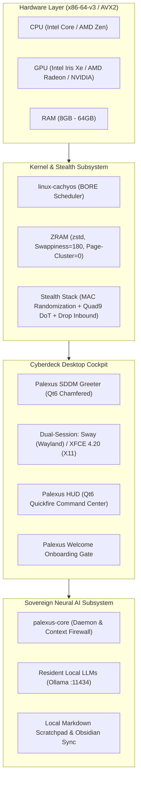

<div align="center">

```text
  ██████╗  █████╗ ██╗     ███████╗██╗  ██╗██╗   ██╗███████╗     ██████╗ ███████╗
  ██╔══██╗██╔══██╗██║     ██╔════╝╚██╗██╔╝██║   ██║██╔════╝    ██╔═══██╗██╔════╝
  ██████╔╝███████║██║     █████╗   ╚███╔╝ ██║   ██║███████╗    ██║   ██║███████╗
  ██╔═══╝ ██╔══██║██║     ██╔══╝   ██╔██╗ ██║   ██║╚════██║    ██║   ██║╚════██║
  ██║     ██║  ██║███████╗███████╗██╔╝ ██╗╚██████╔╝███████║    ╚██████╔╝███████║
  ╚═╝     ╚═╝  ╚═╝╚══════╝╚══════╝╚═╝  ╚═╝ ╚═════╝ ╚══════╝     ╚═════╝ ╚══════╝
```

### **The Sovereign Neural Cyberdeck Operating System**  
*Surgical Precision. Zero Telemetry. One Silicon Brain.*

[](build/verify-gates.sh)
[](tests/test_ui_ux.py)
[](https://archlinux.org)
[-fab387?style=flat-square&logo=linux&logoColor=ffffff)](https://github.com/CachyOS/linux-cachyos)
[-f38ba8?style=flat-square&logo=privatedivision&logoColor=ffffff)](#-the-prime-directive-zero-telemetry-sovereignty)
[](LICENSE)

<br/>


<br/>

**PalexusOS** is an open-source, AI-native rolling Linux operating system engineered to reclaim personal computing from pervasive cloud telemetry, surveillance diagnostics, forced subscriptions, and interface bloat. Engineered with low-latency BORE kernel scheduling, aggressive ZRAM zstd memory compression, and deeply integrated resident local neural models, PalexusOS transforms any modern x86-64 machine into an ultra-responsive, sovereign cyberdeck.

[**60-Second Virtual Test Drive**](#-60-second-virtual-test-drive-no-usb-required) • [**Install in 3 Steps**](#-get-started-in-3-steps) • [**System Architecture**](#-system-architecture--subsystems) • [**Hardware Matrix**](#-supported-hardware-matrix) • [**UI/UX Verification**](docs/UI_UX_AUDIT_REPORT.md) • [**Boot Video Suite**](docs/PALEXUS_BOOT_VIDEO_SUITE.md)

</div>

---

## ⚡ Why PalexusOS? (Core Philosophy)

Commercial operating systems treat your silicon as a thin client terminal to ingest telemetry, harvest keystrokes, and bill ongoing subscriptions for basic machine intelligence.

**PalexusOS shifts the paradigm:**

* 🧠 **Your AI Lives on Your Silicon**: Tap **`Super + Space`** or **`Super + S`** anywhere to summon your local neural copilot. Query technical documentation, generate code, refactor codebases, and trigger system commands. The weights run **100% locally on your CPU and GPU via resident Ollama models** (`qwen2.5-coder:latest`, `llama3.2`)—zero token meters, zero latency, and total privacy on airplane mode.
* 🛡️ **The Prime Directive (Zero Telemetry)**: Every network interface enforces hardware MAC address randomization for both scan probes and active associations. IPv6 privacy extensions (RFC 4941) are active by default. All outbound DNS queries are encrypted over TLS via Quad9 (`9.9.9.9:853`), and system daemons operate with a default-drop inbound firewall posture.
* 🚀 **Instantaneous Response (BORE Scheduler & AVX2)**: Utilizing `linux-cachyos` with the **Burst-Oriented Response Enhancer (BORE)**, interactive terminal typing and UI animations retain microsecond priority even under 100% CPU multi-threaded local AI inference or kernel compilation.
* 🛡️ **Sub-Second Btrfs Snapshot Protection**: Every package transaction generates an atomic read-only Btrfs snapshot. If an upstream regression occurs, roll your entire workstation back in under 5 seconds directly from the bootloader.
* 🎨 **Monolithic Cyberdeck Aesthetics**: Designed with chamfered obsidian glass, liquid silver chrome typography, Catppuccin Mocha Mauve accents, laser-engraved Plymouth boot animations, and 4 bespoke CNC vector icon themes.

---

## 📊 How PalexusOS Compares

| Feature | Windows 11 Copilot+ | Ubuntu 24.04 LTS | Vanilla Arch Linux | CachyOS | **PalexusOS** |
| :--- | :---: | :---: | :---: | :---: | :---: |
| **Local AI Subsystem** | ❌ Cloud / NPU Only | ❌ None | ❌ DIY | ❌ DIY | **✅ Native Core & HUD** |
| **Context & Secret Firewall**| ❌ Telemetry Ingestion | ❌ None | ❌ None | ❌ None | **✅ Bidirectional Proxy** |
| **System Telemetry** | ⚠️ Pervasive / Diagnostic | ⚠️ Opt-out Metrics | ✅ Zero Default | ✅ Minimal | **🛡️ 0 (Prime Directive)** |
| **CPU Scheduler Tuning** | Standard Round-Robin | CFS / EEVDF | Standard EEVDF | BORE / BMQ | **🚀 BORE + Auto-Nicing** |
| **Microarchitecture Binaries**| Generic x86-64 | Generic x86-64 | Generic x86-64 | x86-64-v3/v4 | **⚡ x86-64-v3 (AVX2/BMI2)** |
| **Memory Compression** | Basic Pagefile | Basic Swap | DIY | ZRAM zstd | **💾 8GB ZRAM (180 Swappiness)** |
| **Rollback Time Machine** | System Restore (Slow) | Manual TimeShift | DIY Btrfs | Automated Snapper | **✅ 5-Second Boot Snapshots** |
| **First-Boot Experience** | Mandatory Online Account | Generic Installer | Terminal CLI | Calamares | **✨ Cyberdeck Cockpit Wizard** |

---

## 🏛 System Architecture & Subsystems



---

## ⌨️ Mnemonic Keybinding Cheat Sheet

| Keybinding | Target Action | Subsystem / Component |
| :--- | :--- | :--- |
| `[Mod4] + [Space]` | **Summon Command HUD / AI Copilot** | `palexus-hud` (Global Quickfire overlay) |
| `[Mod4] + [S]` | **Summon Command HUD / AI Copilot** | `palexus-hud` (Mnemonic Search / AI) |
| `[Mod4] + [Return]` | **Spawn GPU-Accelerated Terminal** | Kitty terminal with JetBrains Mono |
| `[Mod4] + [B]` | **Launch Hardened Web Browser** | Chromium (Telemetry & Sync disabled) |
| `[Mod4] + [F]` | **Launch Native File Manager** | Thunar (Fast XFCE file navigation) |
| `[Mod4] + [I]` | **Launch System Disk Installer** | Calamares Btrfs installer (`calamares -d`) |
| `[Mod4] + [K]` | **Display Shortcuts HUD** | Floating keybinding reference cheat sheet |
| `[Mod4] + [Ctrl] + [T]` | **Interactive Theme Switcher** | `palexus-theme` palette menu |
| `[Mod4] + [Shift] + [Q]` | **Close Focused Window** | Window manager close binding |

---

## 🎨 Colorway & Design Tokens

PalexusOS adheres to a strict tactile cyberdeck design system:

| Token Name | Hex Code | Sample | Purpose |
| :--- | :---: | :---: | :--- |
| **Electric Mauve (Default)** | `#cba6f7` |  | Primary cyberdeck accent, glowing trails, active borders |
| **Warm Tungsten Gold** | `#fab387` |  | Industrial hardware warning, BORE scheduler telemetry |
| **Stealth Crimson** | `#f38ba8` |  | Firewall drops, Tor isolation, authentication failure shake |
| **Aerospace Sapphire** | `#74c7ec` |  | Audio subsystem, Quad9 DoT status, cold chromium highlights |
| **Matrix Emerald** | `#a6e3a1` |  | Local AI online status (`:11434`), verified security posture |
| **Liquid Silver Chrome** | `#cdd6f4` |  | Extruded 3D wordmark typography, keycap legends |
| **Smoked Obsidian Crust** | `#11111b` |  | Chamfered window background, Plymouth zero-flicker handoff |

---

## 🧪 60-Second Virtual Test Drive (No USB Required!)

Test drive PalexusOS inside a high-performance QEMU virtual machine with full UEFI support:

```bash
# Clone the repository
git clone https://github.com/earnerbaymalay/synapseOS.git palexusOS
cd palexusOS

# Run the 261-gate engineering verification suite
./build/verify-gates.sh

# Build native packages & live ISO (requires privileged Arch environment or Docker)
./build/build-iso.sh --dry-run
```

---

## 🛡️ The Prime Directive (Zero-Telemetry Sovereignty)

PalexusOS guarantees that no telemetry packet leaves your machine without your explicit consent:
1. **NetworkManager Hardware MAC Randomization**: `wifi.scan-rand-mac-address=yes`, `ethernet.cloned-mac-address=random`, `wifi.cloned-mac-address=random`.
2. **RFC 4941 IPv6 Privacy Extensions**: Ephemeral temporary global IPv6 addresses rotated automatically.
3. **Quad9 DNS-over-TLS (DoT)**: Systemd-resolved stub resolver bound to `9.9.9.9:853` with strict DNSSEC certificate verification.
4. **Hardened Chromium Profile**: Embedded flags `--disable-sync`, `--disable-metrics`, `--disable-breakpad`, `--no-default-browser-check`.

---

## 📜 Packaging & Subsystem Recipes

| Subsystem Package | Recipe Location | Binary & Deliverables |
| :--- | :--- | :--- |
| `palexus-core` | [`packages/core/palexus-core/PKGBUILD`](packages/core/palexus-core/PKGBUILD) | `palexus`, `palexus.service`, `palexus-sync.timer` |
| `palexus-hud` | [`packages/desktop/palexus-hud/PKGBUILD`](packages/desktop/palexus-hud/PKGBUILD) | `palexus-hud`, `palexus-welcome`, `palexus-settings`, `palexus-notes` |
| `palexus-greeter` | [`packages/desktop/palexus-greeter/PKGBUILD`](packages/desktop/palexus-greeter/PKGBUILD) | SDDM Qt6 Greeter theme (`palexusos`) |
| `palexus-plymouth` | [`packages/desktop/palexus-plymouth/PKGBUILD`](packages/desktop/palexus-plymouth/PKGBUILD) | Plymouth DRM/KMS boot splash (`palexus-boot.mp4`) |
| `palexus-themes` | [`packages/desktop/palexus-themes/PKGBUILD`](packages/desktop/palexus-themes/PKGBUILD) | `palexus-theme`, `palexus-screensaver`, 14 curated wallpapers |

---

<div align="center">
<b>PalexusOS · Built for Sovereignty, Speed, and Intelligence.</b><br/>
<sub>100% Free & Open Source Software. Dual licensed under MIT and GPLv3.</sub>
</div>
