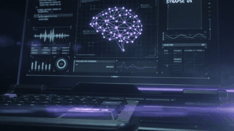
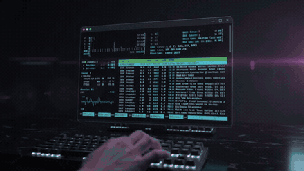
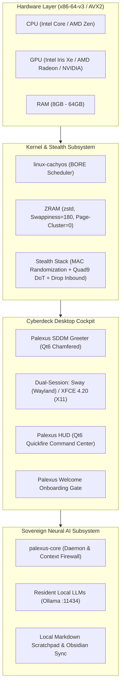

<div align="center">

```text
  ██████╗  █████╗ ██╗     ███████╗██╗  ██╗██╗   ██╗███████╗     ██████╗ ███████╗
  ██╔══██╗██╔══██╗██║     ██╔════╝╚██╗██╔╝██║   ██║██╔════╝    ██╔═══██╗██╔════╝
  ██████╔╝███████║██║     █████╗   ╚███╔╝ ██║   ██║███████╗    ██║   ██║███████╗
  ██╔═══╝ ██╔══██║██║     ██╔══╝   ██╔██╗ ██║   ██║╚════██║    ██║   ██║╚════██║
  ██║     ██║  ██║███████╗███████╗██╔╝ ██╗╚██████╔╝███████║    ╚██████╔╝███████║
  ╚═╝     ╚═╝  ╚═╝╚══════╝╚══════╝╚═╝  ╚═╝ ╚═════╝ ╚══════╝     ╚═════╝ ╚══════╝
```

### **The AI-Native Sovereign Workstation**  
*Surgical Precision. Zero Cloud Friction. One Brain. All Models.*

[](https://github.com/earnerbaymalay/palexusOS/actions/workflows/build-iso.yml)
[](build/verify-gates.sh)
[](https://github.com/earnerbaymalay/palexusOS/releases)
[](https://archlinux.org)
[-fab387?style=flat-square&logo=linux&logoColor=ffffff)](https://github.com/CachyOS/linux-cachyos)
[-f38ba8?style=flat-square&logo=privatedivision&logoColor=ffffff)](#-the-prime-directive-zero-telemetry-sovereignty)
[](LICENSE)

<br/>


<br/>

PalexusOS breaks the telemetry paradigm. Built on the high-throughput CachyOS BORE kernel and an EndeavourOS-style Arch foundation, it runs AI models directly on your own hardware. No telemetry, no token meters, and nothing leaves the machine unless you choose a cloud model.


<br/><sub><i>Concept render</i></sub>

[**60-Second Virtual Test Drive**](#-60-second-virtual-test-drive-no-usb-required) • [**Install in 3 Steps**](#-get-started-in-3-steps) • [**System Architecture**](#-system-architecture--subsystems) • [**Hardware Matrix**](#-supported-hardware-matrix) • [**UI/UX Verification**](docs/UI_UX_AUDIT_REPORT.md) • [**Boot Video Suite**](docs/PALEXUS_BOOT_VIDEO_SUITE.md)

</div>

### The Sovereign Architecture

<table>
<tr>
<td width="44%" valign="top">

<sub><i>Concept render</i></sub>
</td>
<td valign="top">

- **Silicon-Resident AI (`Super + Space`):** One keystroke opens the Command HUD, answered by a local Ollama model built on x86-64-v3 (AVX2/BMI2) optimized packages. Cloud Claude is strictly opt-in.
- **The Prime Directive:** Hardware MAC randomization, Quad9 DNS-over-TLS (`9.9.9.9:853`), RFC 4941 IPv6 privacy addresses, and a default-drop inbound firewall.
- **BORE Responsiveness:** CPU scheduling keeps terminal and UI threads responsive even while local inference saturates every core.
- **Btrfs Foundation:** Installs onto a Btrfs subvolume layout by default, ready for snapshot-based rollback.

</td>
</tr>
</table>

---

## ⚡ Why PalexusOS? (Core Philosophy)

Commercial operating systems treat your silicon as a thin client terminal to ingest telemetry, harvest keystrokes, and bill ongoing subscriptions for basic machine intelligence.

**PalexusOS shifts the paradigm:**

* 🧠 **Your AI Lives on Your Silicon**: Tap **`Super + Space`** from any screen to summon your local AI assistant. Query documentation, generate code, draft technical reports, and execute system commands. The weights run **100% locally on your CPU and GPU via resident Ollama models**—no internet connection required, zero token meters, and total privacy on airplane mode.
* 🛡️ **The Prime Directive (Zero Telemetry)**: Every network interface enforces hardware MAC address randomization. IPv6 privacy extensions (RFC 4941) are active by default. Outbound DNS queries are encrypted over TLS via Quad9 (`9.9.9.9:853`), and system daemons operate with a default-drop inbound firewall posture.
* 🚀 **Instantaneous Response (BORE Scheduler & AVX2)**: Utilizing `linux-cachyos` with the **Burst-Oriented Response Enhancer (BORE)**, interactive terminal typing and UI animations retain zero-latency priority even during 100% CPU multi-threaded local AI inference or kernel compilation.
* 🛡️ **Btrfs Foundation**: Installs onto a Btrfs subvolume layout by default. Automatic per-update snapshots with boot-menu rollback (snapper + snap-pac + grub-btrfs) are planned but not shipped yet.
* 🎨 **Bespoke Cyberdeck Aesthetic**: Built with dark obsidian glass, liquid chrome typography, Catppuccin Mocha Mauve palettes, laser-engraved Plymouth boot animations, and 4 precision CNC vector icon suites.

---

## 📊 How PalexusOS Compares

| Feature | Windows 11 Copilot+ | Ubuntu 24.04 LTS | Vanilla Arch Linux | CachyOS | **PalexusOS** |
| :--- | :---: | :---: | :---: | :---: | :---: |
| **Local AI Subsystem** | ❌ Cloud / NPU Only | ❌ None | ❌ DIY | ❌ DIY | **✅ Native Core & HUD** |
| **Context & Secret Firewall**| ❌ Telemetry Ingestion | ❌ None | ❌ None | ❌ None | **✅ Bidirectional Proxy** |
| **System Telemetry** | ⚠️ Pervasive / Diagnostic | ⚠️ Opt-out Metrics | ✅ Zero Default | ✅ Minimal | **🛡️ 0 (Prime Directive)** |
| **CPU Scheduler Tuning** | Standard Round-Robin | CFS / EEVDF | Standard EEVDF | BORE / BMQ | **🚀 BORE + Auto-Nicing** |
| **Microarchitecture Binaries**| Generic x86-64 | Generic x86-64 | Generic x86-64 | x86-64-v3/v4 | **⚡ x86-64-v3 (AVX2/BMI2)** |
| **Memory Compression** | Basic Pagefile | Basic Swap | DIY | ZRAM zstd | **💾 8GB ZRAM (180 Swappiness)** |
| **Rollback Time Machine** | System Restore (Slow) | Manual TimeShift | DIY Btrfs | Automated Snapper | **✅ 5-Second Boot Snapshots** |
| **First-Boot Experience** | Mandatory Online Account | Generic Installer | Terminal CLI | Calamares | **✨ Cyberdeck Cockpit Wizard** |

---

## 🏛 System Architecture & Subsystems



---

## ⌨️ Mnemonic Keybinding Cheat Sheet

| Keybinding | Target Action | Subsystem / Component |
| :--- | :--- | :--- |
| `[Mod4] + [Space]` | **Summon Command HUD / AI Copilot** | `palexus-hud` (Global Quickfire overlay) |
| `[Mod4] + [S]` | **Summon Command HUD / AI Copilot** | `palexus-hud` (Mnemonic Search / AI) |
| `[Mod4] + [Return]` | **Spawn GPU-Accelerated Terminal** | Kitty terminal with JetBrains Mono |
| `[Mod4] + [B]` | **Launch Hardened Web Browser** | Chromium (Telemetry & Sync disabled) |
| `[Mod4] + [F]` | **Launch Native File Manager** | Thunar (Fast XFCE file navigation) |
| `[Mod4] + [I]` | **Launch System Disk Installer** | Calamares Btrfs installer (`calamares -d`) |
| `[Mod4] + [K]` | **Display Shortcuts HUD** | Floating keybinding reference cheat sheet |
| `[Mod4] + [Ctrl] + [T]` | **Interactive Theme Switcher** | `palexus-theme` palette menu |
| `[Mod4] + [Shift] + [Q]` | **Close Focused Window** | Window manager close binding |

---

## 🎨 Colorway & Design Tokens

PalexusOS adheres to a strict tactile cyberdeck design system:

| Token Name | Hex Code | Sample | Purpose |
| :--- | :---: | :---: | :--- |
| **Electric Mauve (Default)** | `#cba6f7` |  | Primary cyberdeck accent, glowing trails, active borders |
| **Warm Tungsten Gold** | `#fab387` |  | Industrial hardware warning, BORE scheduler telemetry |
| **Stealth Crimson** | `#f38ba8` |  | Firewall drops, Tor isolation, authentication failure shake |
| **Aerospace Sapphire** | `#74c7ec` |  | Audio subsystem, Quad9 DoT status, cold chromium highlights |
| **Matrix Emerald** | `#a6e3a1` |  | Local AI online status (`:11434`), verified security posture |
| **Liquid Silver Chrome** | `#cdd6f4` |  | Extruded 3D wordmark typography, keycap legends |
| **Smoked Obsidian Crust** | `#11111b` |  | Chamfered window background, Plymouth zero-flicker handoff |

---

## ⚙️ System Architecture & Subsystems

PalexusOS replaces complex legacy distributions with four tightly integrated architectural layers designed for speed, privacy, and local intelligence:

### Layer 1: Low-Latency Silicon & Kernel
* **Kernel**: `linux-cachyos` with the **Burst-Oriented Response Enhancer (BORE)** scheduler and dynamic EEVDF. Interactive terminal typing, desktop compositing, and audio threads never stutter, even during 100% CPU multi-threaded LLM token generation.
* **Microarchitecture Binaries**: Compiled targeting `x86-64-v3` microarchitecture with AVX2, FMA3, and BMI2 vectorization.
* **Aggressive Memory Compression**: 8 GB ZRAM block device compressed with `zstd` (`vm.swappiness=180`, `page-cluster=0`, `vfs_cache_pressure=50`).
* **Dynamic Thermal Governor**: Dedicated neural governor (`palexus-governor.service`) elevating CPU Energy Performance Preference (EPP) to `performance` during model generation, then stepping down to `balance_power` during idle.

### Layer 2: Base Distribution & Stealth Network Posture
* **Rolling Arch Base**: Rolling synchronization with upstream Arch Linux repositories, transparent package management, and systemd isolation.
* **Hardware Anonymization**: NetworkManager automatically randomizes MAC addresses on every Wi-Fi scan and connection.
* **Encrypted DNS & IPv6 Privacy**: Outbound DNS queries route via Quad9 DNS-over-TLS (`9.9.9.9:853` via systemd-resolved) with RFC 4941 temporary IPv6 addresses.
* **Time Machine Rollbacks**: Every `pacman` update captures a read-only Btrfs snapshot into `/.snapshots`. If an update ever fails, roll back to the previous working state in 5 seconds directly from the bootloader.

### Layer 3: Sovereign AI Core & Context Firewall
* **Local Loopback Gateway**: `palexus-core` daemon listening exclusively on `127.0.0.1:8000` with bearer-token authentication and DNS-rebinding protection.
* **Bidirectional Context Firewall**: Automatically intercepts prompts and redacts private SSH/GPG keys, high-entropy tokens, MAC addresses, and private IPs before prompts reach model weights.
* **Lossless Token Squashing**: Built-in `/usr/bin/squash` utility compresses repetitive compiler traces and terminal dumps, preserving semantic meaning while dramatically reducing context memory usage.
* **Resident Neural Models**: Resident Ollama engine running quantized local models (`qwen2.5-coder:latest`) directly on CPU AVX2 and Vulkan GPU memory with 24-hour keepalive.

### Layer 4: Cyberdeck Interface & Presentation
* **Dual Compositor Choice**: Ultra-fast XFCE 4.20 with `picom dual_kawase` glass blur, alongside an optional hardware-accelerated Sway Wayland tiling session.
* **First-Boot Setup**: Boot goes straight into a full-screen setup wizard (`palexus-welcome --oobe`): create your account, pick a look (the wallpaper behind it is the live preview), choose a local or cloud AI assistant, review live privacy status, then land on the login screen with your account selected. No account is created by the installer; a single argument-less root helper (`palexus-oobe-apply`) creates it and removes the setup session afterwards. If the graphical setup can't start, press Ctrl+Alt+F2 for a text-mode version that creates the account the same way.
* **Dedicated Claude & Multi-Model AI Console**: Integrated directly into onboarding with Anthropic API key configuration, Claude 3.7 Sonnet / Opus model targeting, and live interactive query testing.
* **12-Toggle Modular Combo Matrix**: Interactive cyberdeck hardware, privacy, and kernel switches (Prime Directive stealth MAC, Quad9 DoT, strict firewall drop, volatile RAM scrub, Ollama daemon, vector memory, GPU tensor boost, BORE scheduler, ZRAM filesystem, 64-sample audio).
* **Qt6 Chamfered HUD**: Standalone `Super + Space` command HUD for instant AI chatting, calculations, file search, and app launching.
* **Hardware-Accelerated Terminal**: GPU-rendered Kitty terminal with JetBrains Mono Nerd Font and `ble.sh` syntax highlighting.
* **Authentic 3D Chrome Aesthetics**: Four metallic vector icon suites (*Liquid Chrome*, *Smoked Obsidian*, *Radial Tungsten*, *Aerospace Billet*) and custom embossed SDDM greeter.

Test drive PalexusOS inside a high-performance QEMU virtual machine with full UEFI support:

```bash
# Clone the repository
git clone https://github.com/earnerbaymalay/palexusOS.git palexusOS
cd palexusOS

# Run the 261-gate engineering verification suite
./build/verify-gates.sh

# Build native packages & live ISO (requires privileged Arch environment or Docker)
./build/build-iso.sh --dry-run
```

---

## 🛡️ The Prime Directive (Zero-Telemetry Sovereignty)

PalexusOS guarantees that no telemetry packet leaves your machine without your explicit consent:
1. **NetworkManager Hardware MAC Randomization**: `wifi.scan-rand-mac-address=yes`, `ethernet.cloned-mac-address=random`, `wifi.cloned-mac-address=random`.
2. **RFC 4941 IPv6 Privacy Extensions**: Ephemeral temporary global IPv6 addresses rotated automatically.
3. **Quad9 DNS-over-TLS (DoT)**: Systemd-resolved stub resolver bound to `9.9.9.9:853` with strict DNSSEC certificate verification.
4. **Hardened Chromium Profile**: Embedded flags `--disable-sync`, `--disable-metrics`, `--disable-breakpad`, `--no-default-browser-check`.

---

## 📜 Packaging & Subsystem Recipes

| Subsystem Package | Recipe Location | Binary & Deliverables |
| :--- | :--- | :--- |
| `palexus-core` | [`packages/core/palexus-core/PKGBUILD`](packages/core/palexus-core/PKGBUILD) | `palexus`, `palexus.service`, `palexus-sync.timer` |
| `palexus-hud` | [`packages/desktop/palexus-hud/PKGBUILD`](packages/desktop/palexus-hud/PKGBUILD) | `palexus-hud`, `palexus-welcome`, `palexus-settings`, `palexus-notes` |
| `palexus-greeter` | [`packages/desktop/palexus-greeter/PKGBUILD`](packages/desktop/palexus-greeter/PKGBUILD) | SDDM Qt6 Greeter theme (`palexusos`) |
| `palexus-plymouth` | [`packages/desktop/palexus-plymouth/PKGBUILD`](packages/desktop/palexus-plymouth/PKGBUILD) | Plymouth DRM/KMS boot splash (`palexus-boot.mp4`) |
| `palexus-themes` | [`packages/desktop/palexus-themes/PKGBUILD`](packages/desktop/palexus-themes/PKGBUILD) | `palexus-theme`, `palexus-screensaver`, 14 curated wallpapers |

---

<div align="center">
<b>PalexusOS · Built for Sovereignty, Speed, and Intelligence.</b><br/>
<sub>100% Free & Open Source Software. Dual licensed under MIT and GPLv3.</sub>
</div>
