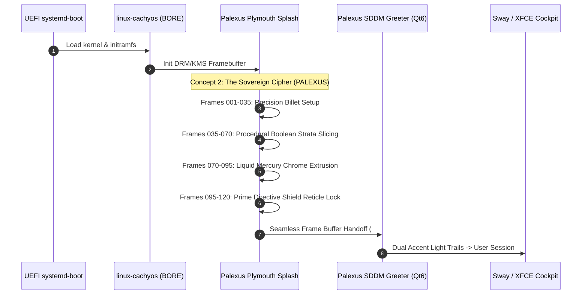

# PalexusOS Monolithic Cyberdeck Boot Video Suite
**Target OS:** PalexusOS (`palexus` / `PalexusOS`)  
**Architecture:** Blender 4.0+ Procedural Automation, Plymouth DRM/KMS, SDDM Greeter  
**Colorway:** Catppuccin Mocha Mauve (`#cba6f7`), Liquid Silver Chrome (`#cdd6f4`), Smoked Obsidian (`#11111b`)  
**Specification:** 120 Frames @ 30 FPS (4.0s loop duration, optimized for NVMe & USB 3.2 Gen 2)

---

## 1. Overview & Concept Architecture

The PalexusOS boot sequence provides an immediate high-end sensory anchor during cold-boot and live-session handoff. Three procedural 3D sequences have been fully authored and automated via Blender 4.0+ Python scripts:



---

## 2. The Three Master Concepts

### Concept 2: "The Sovereign Cipher" (Primary Boot Splash)
* **Theme**: Aerospace Billet / Titanium Vault Plate Excavation & Liquid Chrome Wordmark.
* **Aesthetic**: Dark tungsten/obsidian plate (`#0a0a0f`), neon-mauve plasma kerf (`#cba6f7`), liquid chrome extrusion (`#f5e0dc`).
* **Phases**:
  * **Frames 001–035**: Precision Billet Setup. Chamfered billet plate floats in deep space with micro-etched alignment fiducials.
  * **Frames 035–070**: Procedural Boolean Strata Slicing. Animated cutter sweeps across the plate, excavating an obsidian recess with blazing mauve plasma kerf.
  * **Frames 070–095**: Liquid Mercury Wordmark Extrusion. The `PALEXUS` typography rises vertically out of the molten pool, solidifying into mirror-polished liquid chrome.
  * **Frames 095–120**: Prime Directive Shield Lock. Circular tactical reticle rotates around the wordmark with illuminated progress rails.
* **Blender Asset**: `build/blender/palexus_concept2_cipher.blend`

---

### Concept 3: "Cortical Convolutions" (Neural Topography)
* **Theme**: Biological Cortical Topography (Gyri & Sulci) Sliced by 30° Angled Laser Plane.
* **Aesthetic**: Carbon fiber wafer (`#050508`), undulating displacement waves, incandescent violet fiber-optic conduits.
* **Phases**:
  * **Frames 001–040**: Silicon Neural Topography. Displaced cortical waves undulate in dark space representing resident neural weights.
  * **Frames 040–075**: 30° Angled Boolean Slice. An invisible planar knife shears across the substrate, exposing incandescent violet conduits.
  * **Frames 075–100**: Ferrofluid Magnetic Convergence. Undulating ridges collapse inward and snap into the razor-sharp chrome `PALEXUS OS` emblem.
  * **Frames 100–120**: HUD Ground Projection. Emissive technical grid illuminates displaying BORE scheduler priority and zero-telemetry status.
* **Blender Asset**: `build/blender/palexus_concept3_cortical.blend`

---

### Concept 4: "The Monolithic Prism & Photonic Slicer"
* **Theme**: Translucent Obsidian Monocrystal with Twin Diagonal Cross-Shear Slicers.
* **Aesthetic**: Smoked obsidian glass prism (`#080811`), twin counter-angled laser blades, photonic emission core.
* **Phases**:
  * **Frames 001–035**: Monocrystal Idle. Rotating chamfered dark obsidian glass prism with dormant sub-zero neural pathways faintly glowing inside.
  * **Frames 035–070**: Twin Boolean Cross-Cut. Two intersecting diagonal cutters sweep through, leaving blazing liquid chrome and mauve light on all cut facets.
  * **Frames 070–095**: Kinetic Aperture Burst. Prism segments slide open along 45° rails like an iris, releasing a photonic laser beam that flash-freezes into `PALEXUS OS`.
  * **Frames 095–120**: Monolithic Lock. Outer crystal sections snap shut forming an armored backplate with holographic boot telemetry.
* **Blender Asset**: `build/blender/palexus_concept4_prism.blend`

---

## 3. Automation Script Execution

The complete automation suite is located at:
`build/blender/generate_palexus_boot_videos.py`

### Generating Scenes Headless:
```bash
# Build & save .blend files
blender -b -P build/blender/generate_palexus_boot_videos.py -- --concept 2 --wordmark PALEXUS --save-blend build/blender/palexus_concept2_cipher.blend
blender -b -P build/blender/generate_palexus_boot_videos.py -- --concept 3 --wordmark "PALEXUS OS" --save-blend build/blender/palexus_concept3_cortical.blend
blender -b -P build/blender/generate_palexus_boot_videos.py -- --concept 4 --wordmark "PALEXUS OS" --save-blend build/blender/palexus_concept4_prism.blend
```

### Rendering Animation to MP4 & Plymouth Frames:
```bash
# Render all 120 PNG frames
blender -b build/blender/palexus_concept2_cipher.blend -o build/blender/renders/concept2/frame_#### -F PNG -a

# Encode directly to H.264 MP4 (1080p @ 30fps)
ffmpeg -y -framerate 30 -i build/blender/renders/concept2/frame_%04d.png -c:v libx264 -pix_fmt yuv420p build/blender/palexus_boot_concept2.mp4
```

---

## 4. Plymouth Splash Integration

To compile the animation frames directly into the `palexus-plymouth` package:

```bash
# Extract frames from MP4 into Plymouth theme directory
ffmpeg -y -i packages/desktop/palexus-plymouth/palexus-boot.mp4 -vf "fps=30" -pix_fmt rgb24 packages/desktop/palexus-plymouth/frame-%03d.png
```

The Plymouth script (`packages/desktop/palexus-plymouth/palexusos.script.in`) handles:
1. Frame-by-frame loop playback during kernel and service initialization.
2. Holding the final frame (`frame-120.png`) with clean ambient glow.
3. Seamless zero-flicker handoff into the SDDM greeter at `#11111b`.
